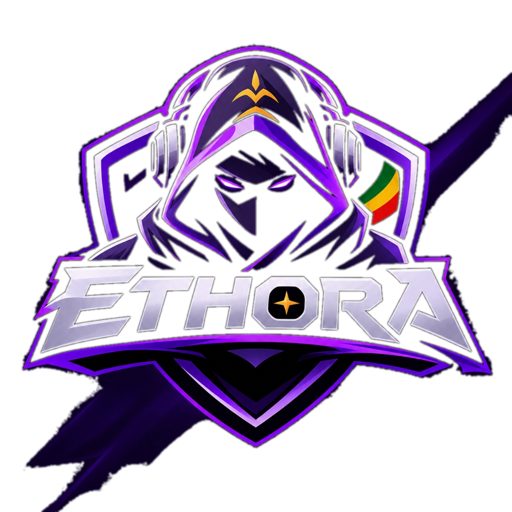

<p align="center">
  <a href="#ethora" target="_blank" rel="noopener noreferrer">
    
  </a>
</p>

<h1 align="center">ETHORA</h1>

<p align="center">
  <strong>WHERE GAMERS BECOME LEGENDS.</strong><br>
  <em>The Premier Esports Competition, Tournament & National Ranking Ecosystem for Ethiopia and the Horn of Africa.</em>
</p>

<p align="center">
  <a href="https://nextjs.org"></a>
  <a href="https://react.dev"></a>
  <a href="https://www.typescriptlang.org"></a>
  <a href="https://tailwindcss.com"></a>
  <a href="https://t.me/ethora_ranker_bot"></a>
  
  
  
</p>

<p align="center">
  <a href="#-overview">Overview</a> •
  <a href="#-telegram-bot-web-app-integration">Telegram Web App</a> •
  <a href="#-key-features">Key Features</a> •
  <a href="#-backend-rest-api-persistence">REST APIs</a> •
  <a href="#-interactive-ethiopian-payment-simulator">Ethiopian Checkout</a> •
  <a href="#-tech-stack">Tech Stack</a> •
  <a href="#-quick-start">Quick Start</a> •
  <a href="#-demo-credentials--roles">Demo Accounts</a> •
  <a href="#-documentation">Docs</a>
</p>

---

## 🌟 Overview

**ETHORA** is the central digital infrastructure uniting gamers, competitive teams, and tournament organizers across Ethiopia and East Africa. Designed with an esports cyber-arena aesthetic, ETHORA provides real-time bracket orchestration, verified national rankings (Elo/MMR), squad/clan management, an integrated AI gaming assistant, simulated Ethiopian mobile money checkout (Telebirr & CBE Birr) with stamped digital tournament passes, and a dedicated **Telegram Mini App** for instant mobile access.

Whether competing in high-stakes LAN tournaments at Millennium Hall, climbing regional ladders across Addis Ababa, Hawassa, or Dire Dawa, or organizing grassroots community cups, ETHORA powers the complete competitive journey.

---

## ✈️ Telegram Bot Web App Integration

ETHORA is directly connected to Telegram—the primary platform for the Ethiopian gaming community:

<p align="center">
  <a href="https://t.me/ethora_ranker_bot" target="_blank" rel="noopener noreferrer">
    
  </a>
</p>

- **Official Bot**: [`@ethora_ranker_bot`](https://t.me/ethora_ranker_bot)
- **Zero-Install Experience**: Players can launch the complete ETHORA experience directly inside Telegram via Telegram Web Apps (TWA) without downloading external apps.
- **Instant Leaderboard Lookups**: Check real-time national Elo standings, regional ranks (Addis Ababa, Oromia, Amhara, etc.), and top champions on the go.
- **Tournament Push Notifications & Passes**: View digital tournament tickets, match seedings, and bracket timings directly on your phone.
- **Mobile Touch-Optimized**: Ultra-responsive layout designed for handheld mobile viewports, fast loading on Ethio Telecom 4G/LTE/Fiber.

---

## ⚡ Key Features

### 🏆 1. Tournament Engine & Live Brackets
- **Multi-Format Support**: Single Elimination, Double Elimination, Swiss, and Group Stage tournaments.
- **Live Database Bracket Sync**: Interactive double-elimination bracket visualizer with persistent live score updates (`PATCH /api/tournaments/[id]/brackets`).
- **Prize Pool Tracking**: Integrated tracking for verified cash pools (ETB) and digital trophies.
- **Organizer Score Arbitration**: Real-time score recording and dispute resolution restricted to organizer and administrator roles.

### 📱 2. Interactive Ethiopian Mobile Money Checkout
- **Telebirr & CBE Birr Simulation**: Choose between Ethio Telecom's **Telebirr** and Commercial Bank of Ethiopia's **CBE Birr**.
- **Interactive USSD PIN Prompt**: Simulates mobile screen takeover with 4-digit security PIN verification.
- **Stamped Digital Entry Pass**: Generates official `ET-TX-######` receipt stamps with bracket seed allocation and printable passes.

### 👑 3. National Rankings & 3-Column Olympic Podium
- **Mobile & Desktop Olympic Podium**: 3-column responsive layout (`grid-cols-3`) ensuring the **#1 APEX LEADER** is prominently elevated in gold in the center, flanked by **#2 Silver** and **#3 Bronze** across all screen sizes.
- **Tier Progression**: Structured tier classification (*Rookie*, *Challenger*, *Elite*, *Master*, *Immortal*, *Legend*).
- **Geographic Anchoring**: Hierarchy matching Ethiopian administrative divisions (*Region → Zone → Woreda → Local Cyber Lounge*).
- **Cross-Game MMR**: Dynamic rating adjustments based on performance, win streaks, and tournament multipliers.

### 👤 4. Professional Profile & Secure Sign Out Modal
- **Clean In-App Profile Menu**: Displays active athlete passport info, verified status badge, quick links to Profile and Settings, without cluttered persona switchers.
- **Security Confirmation Modal**: Clicking "Sign Out" presents an explicit confirmation dialog (*"Sign Out Confirmation"*) with active user preview before safely ending the session.
- **Login-Isolated Demo Accounts**: All persona switching and demo accounts are securely isolated to the official Sign In page.

### 🗄️ 5. Relational SQLite & REST API Persistence
- **Prisma Schema**: Full relational database (`prisma/ethora.db`) covering `User`, `GamerProfile`, `Tournament`, `TournamentRegistration`, `Team`, `Notification`, and `VerificationRequest`.
- **Pre-Seeded Roster**: Comes loaded with 10 demo users, 12 verified athletes (including ViperX with full combat stats & achievements), 6 tournaments, and 5 teams.

### 🔐 6. Simulated Social OAuth & Cryptographic Security
- **Interactive OAuth Consent Dialogs**: Support for **Discord**, **Google**, and **Twitch** with one-click gamer onboarding and automatic avatar allocation.
- **SHA-256 Password Hashing**: Client-side cryptographic hashing (`quickHash`) preventing plaintext password storage in browser memory.

### 🖼️ 7. Offline Esports Avatars & Canvas Compression
- **6 Local Cyberpunk SVG Avatars**: Standalone vector presets (`Viper`, `Lion`, `Rift`, `Apex`, `Habesha`, `Zen`) requiring zero external network requests.
- **Client-Side Canvas Compression**: HTML5 `<canvas>` compression engine (`src/lib/imageUpload.ts`) automatically downscaling user-uploaded avatars and tournament banners to lightweight WebP (<50KB).

### 🤖 8. ETHORA AI Gaming Assistant
- **Context-Aware Co-Pilot**: Answers player inquiries regarding upcoming tournaments, local meta strategies, rulesets, and registration deadlines.
- **Direct Tournament Deep Links**: Immediate action links to bracket visualizers and open registrations.
- **Direct Tournament Deep Links**: Immediate action links to bracket visualizers and open registrations.

---

## 💳 Interactive Ethiopian Payment Simulator

The tournament registration flow features an authentic Ethiopian mobile fintech checkout modal (`src/components/tournament/EthiopianCheckoutModal.tsx`):

```
┌────────────────────────────────────────────────────────┐
│  Tournament Registration & Checkout                   ✕│
├────────────────────────────────────────────────────────┤
│  1. Roster Info   ▶   2. Telebirr / CBE   ▶   3. Pass  │
├────────────────────────────────────────────────────────┤
│  Select Provider:                                      │
│  ┌───────────────────────┐   ┌───────────────────────┐ │
│  │ 📱 telebirr           │   │ 🏦 CBE Birr           │ │
│  │ Ethio Telecom         │   │ Commercial Bank       │ │
│  └───────────────────────┘   └───────────────────────┘ │
│                                                        │
│  Phone: +251 [ 0911234567               ]              │
│  Total: 250 ETB • Recipient: Ethora Esports Hub        │
│                                                        │
│  [  Send USSD PIN Prompt  ]                            │
│                                                        │
│  USSD Prompt: Enter 4-Digit Security PIN: [ • • • • ]  │
│  [ Confirm & Authorize ]                               │
├────────────────────────────────────────────────────────┤
│  ★ OFFICIAL STAMPED ENTRY PASS: ET-TX-849201           │
│  Allocated Bracket Seed: SEED #4                       │
└────────────────────────────────────────────────────────┘
```

---

## 🎨 Offline Avatars & Media System

All avatars and presentation banners are designed to be completely offline-resilient:
- **Local Presets**: Stored in `public/images/avatars/`:
  - `avatar-viper.svg` (Viper Duelist)
  - `avatar-lion.svg` (LionCity Ops)
  - `avatar-rift.svg` (Rift Syndicate)
  - `avatar-apex.svg` (Apex Warrior)
  - `avatar-habesha.svg` (Habesha Crest)
  - `avatar-zenmaster.svg` (Zen Precision)
- **Local Arena Backdrops**: `ethora-stadium-banner.jpg` (Millennium Hall Addis Ababa), `login-arena-clean.jpg` (Vanguard Stage), `ethora-ranking-bg.png` (Apex Grid).
- **Canvas Compression**: Custom images are scaled and exported as compressed WebP Data URLs, ensuring safe coexistence within `localStorage`.

---

## 🛠️ Tech Stack

| Layer | Technology | Description |
| :--- | :--- | :--- |
| **Framework** | [Next.js 14.2](https://nextjs.org/) (App Router) | React Server Components, client routing, and asset optimization |
| **Language** | [TypeScript 5.0](https://www.typescriptlang.org/) | Strict type checking with 0 build errors |
| **Styling** | [Tailwind CSS 3.4](https://tailwindcss.com/) | Cyberpunk dark theme palette (`#05030D`, `#0E101B`, `#A855F7`) |
| **Icons** | [Lucide React](https://lucide.dev/) | Clean vector iconography |
| **Image Processing** | HTML5 Canvas API | In-browser client-side image compression (<50KB WebP) |
| **Database & ORM** | [SQLite](https://www.sqlite.org/) + [Prisma ORM](https://www.prisma.io/) | Self-contained relational database (`prisma/ethora.db`) with full type safety |
| **State & Hydration** | React Context + SQLite REST APIs | Real-time multi-device database sync across PC and mobile over LAN |

---

---

## 🌐 Backend REST API Persistence

ETHORA features a full SQLite REST API backend powered by Prisma ORM (`prisma/ethora.db`), providing persistent multi-device data synchronization across athletes, brackets, and administrative verifications:

| Method | Endpoint | Description |
| :--- | :--- | :--- |
| `GET` | `/api/tournaments` | Fetch all sanctioned Ethiopian tournaments with parsed brackets, rules, and schedules |
| `POST` | `/api/tournaments` | Create and publish a new tournament from the 9-step wizard |
| `GET` | `/api/tournaments/[id]/brackets` | Retrieve real-time bracket match tree and seeding |
| `PATCH` | `/api/tournaments/[id]/brackets` | **Live Match Score Arbitrage**: Update match scores, advance winners, and sync bracket trees |
| `POST` | `/api/tournaments/[id]/register` | Record paid (Telebirr / CBE Birr) or free tournament roster entries |
| `GET` | `/api/gamers` | Fetch all registered national athletes with connected games and ratings |
| `POST` | `/api/gamers` | Upsert athlete profile, bio, regional geography, achievements, and Riot/Steam handles |
| `GET` | `/api/teams` | List competitive rosters, team captains, win rates, and divisions |
| `POST` | `/api/teams` | Register and persist newly founded competitive squads and clans |
| `GET` | `/api/admin/verifications` | Hydrate pending athlete verification requests in the Admin Console |
| `PATCH` | `/api/admin/verifications` | **Approve or reject verification**: Approving automatically marks the athlete as verified in SQLite |

---

## 📂 Project Structure

```bash
ethora/
├── docs/                               # Comprehensive Architecture & Deployment Docs
│   ├── ARCHITECTURE.md                 # System diagrams, state sync, security model
│   ├── ETHIOPIAN_PAYMENTS.md           # Telebirr & CBE Birr simulator & API migration
│   └── PRODUCTION_DEPLOYMENT.md        # Supabase/PostgreSQL schema, S3/R2, Vercel
├── prisma/                             # Database Layer
│   ├── schema.prisma                   # Full relational schema (7 models)
│   ├── ethora.db                       # Local SQLite database
│   └── seed.js                         # Seed script (10 users, 12 athletes, 6 tournaments, etc.)
├── public/                             # Public static assets
│   ├── images/
│   │   ├── avatars/                    # 6 local cyberpunk esports SVG avatars
│   │   ├── ethora-stadium-banner.jpg   # Millennium Hall tournament backdrop
│   │   └── login-arena-clean.jpg       # Vanguard arena background
│   └── ethora-logo.png                 # Official brand logo
├── src/
│   ├── app/                            # Next.js 14 App Router
│   │   ├── admin/                      # Administration console & verification arbitration
│   │   ├── api/                        # REST API endpoints (Prisma SQLite persistence)
│   │   │   ├── admin/verifications/    # GET & PATCH athlete verification requests
│   │   │   ├── gamers/                 # GET & POST athlete profiles & linked accounts
│   │   │   ├── teams/                  # GET & POST competitive rosters & clans
│   │   │   └── tournaments/            # GET, POST tournaments, brackets & registrations
│   │   ├── assistant/                  # AI Assistant portal & Telegram Bot guidance
│   │   ├── auth/                       # Sign In & Sign Up with demo account selectors
│   │   ├── dashboard/                  # Gamer home dashboard (ViperX combat stats)
│   │   ├── gamers/                     # Player directory & leaderboard discovery
│   │   ├── organizer/                  # 9-Step tournament creator & organizer hub
│   │   ├── profile/                    # Profile settings & avatar uploader
│   │   ├── rankings/                   # National 3-column Olympic podium leaderboards
│   │   ├── tournaments/                # Tournament listings, checkout modal & live brackets
│   │   └── page.tsx                    # Cyber arena hero landing page
│   ├── components/                     # Reusable UI components
│   │   ├── auth/                       # OAuthModal, InteractiveAuthMascot
│   │   ├── brand/                      # EthoraLogo, EthoraEmblem
│   │   ├── dashboard/                  # GamerDashboardHeader, combat velocity charts
│   │   ├── layout/                     # Sidebar (clean profile & sign out modal), PublicHeader
│   │   └── tournament/                 # EthiopianCheckoutModal (Telebirr & CBE Birr)
│   ├── context/                        # EthoraContext (State hydration, quickHash, SQLite sync)
│   ├── data/                           # Mock datasets, geography hierarchy, supported games
│   └── lib/                            # Image compression utility (imageUpload.ts), prisma.ts
└── tailwind.config.ts                  # Cyber color palette & glowing drop-shadows
```

---

## 🚀 Quick Start

### 1. Prerequisites
- **Node.js**: `v18.17.0` or higher (tested on Node `v20.x` & `v24.x`)
- **npm**, **yarn**, or **pnpm**

### 2. Installation
```bash
git clone https://github.com/your-username/ethora.git
cd ethora
npm install
```

### 3. Run Development Server
```bash
npm run dev
```
Open [http://localhost:3000](http://localhost:3000) in your browser.

### 4. Build for Production
```bash
npm run build
npm run start
```

### 5. Managing the SQLite Database
- **Open Visual Database Studio**:
  ```bash
  npx prisma studio
  ```
  Opens an interactive GUI in your browser at `http://localhost:5555` to view, query, and edit all athletes, tournaments, registrations, teams, and verifications!
- **Reset or Re-Seed Database**:
  ```bash
  node prisma/seed.js
  ```
- **Direct Database File**:
  Stored locally at `prisma/ethora.db` (can be inspected with [DB Browser for SQLite](https://sqlitebrowser.org/)).

---

## 👥 Demo Credentials & Roles

The platform provides pre-configured role accounts. To ensure a professional UI, persona switching is cleanly located on the **Sign In / Login Page** ([`/auth/signin`](http://localhost:3000/auth/signin)), while the active sidebar profile provides a dedicated **Sign Out Confirmation Dialog**:

| Role | Username / Tag | Email | Password | Access Scope |
| :--- | :--- | :--- | :--- | :--- |
| **Gamer** | `ViperX` | `yared.viper@ethora.et` | `password123` | Join tournaments, Ethiopian checkout, track MMR, combat metrics |
| **Organizer** | `LionCityOps` | `organizer@lioncity.et` | `password123` | Create tournaments (9-step wizard), record bracket scores |
| **Admin** | `RiftAdmin` | `management@greatriftesports.com` | `password123` | Platform oversight, dispute arbitration, athlete verification queue |
| **Organization** | `GreatRift` | `director@greatriftesports.com` | `password123` | Org roster management, recruit free agents, clan contracts |

> *Tip: Social login with Discord, Google, or Twitch works instantly with 1-click simulation on the login page.*

---

## 📚 Documentation

For in-depth guides and deployment references, see the [`docs/`](./docs) directory:
- 📖 [**System Architecture & Data Flow**](./docs/ARCHITECTURE.md)
- 💳 [**Ethiopian Payment Gateways & USSD Integration**](./docs/ETHIOPIAN_PAYMENTS.md)
- 🚢 [**Production Cloud Deployment & Database Schema**](./docs/PRODUCTION_DEPLOYMENT.md)

---

## 📄 License

Distributed under the **MIT License**.

<p align="center">
  <sub>Built with passion for the Ethiopian & African esports gaming community.</sub><br>
  <sub><strong>ETHORA</strong> — Where Gamers Become Legends.</sub>
</p>
