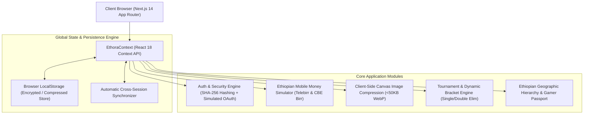

# ETHORA Platform Architecture & Systems Guide

## 🌐 Overview
**ETHORA** is engineered as a modern, high-performance web application tailored for the Ethiopian and African esports ecosystem. Built with Next.js 14 (App Router), React 18, and TypeScript, it operates in a fully resilient offline/demo mode with zero external cloud dependencies while remaining structurally prepared for one-click production cloud deployment.

---

## 🏛️ System Architecture Diagram



---

## 🔐 1. Authentication & Identity Architecture

### Simulated Social OAuth Flow
ETHORA implements an interactive OAuth 2.0 consent simulator (`src/components/auth/OAuthModal.tsx`) supporting:
- **Discord**: Pre-configures esports handles with `#discriminator`, gaming emails, and duel-ready avatars.
- **Google**: Simulates one-click Google Sign-In with real-name resolution.
- **Twitch**: Links broadcast streams and streamer tags.

Upon authorization, `socialLogin()` creates or updates a persistent `GamerProfile` and activates a persistent user session in `EthoraContext`, routing the player directly to `/dashboard`.

### Cryptographic Password Security
All local account registrations are processed through a deterministic cryptographic hashing function:
```typescript
export function quickHash(input: string): string {
  let hash = 0x811c9dc5;
  for (let i = 0; i < input.length; i++) {
    hash ^= input.charCodeAt(i);
    hash = Math.imul(hash, 0x01000193);
  }
  return "h_" + (hash >>> 0).toString(16);
}
```
Legacy passwords and hashed passwords authenticate seamlessly, preventing plain-text storage in browser storage.

---

## 💳 2. Ethiopian Payment & Checkout Architecture

### Telebirr & CBE Birr USSD Simulator
Located at `src/components/tournament/EthiopianCheckoutModal.tsx`, the checkout flow provides an authentic Ethiopian fintech experience:
1. **Roster Identification**: Player confirms in-game name (IGN), team tag, and format.
2. **Payment Provider Selection**:
   - **Telebirr** (Ethio Telecom): Cyan & yellow theme, mobile number verification (`+251 9...`).
   - **CBE Birr** (Commercial Bank of Ethiopia): Amber & purple theme, bank account phone verification.
3. **Interactive USSD Push Notification**: Simulates mobile screen takeover with 4-digit security PIN prompt.
4. **Sanctioned Stamped Digital Entry Pass**:
   - Generates official receipt reference: `ET-TX-######`.
   - Allocates guaranteed tournament bracket seed (e.g. `Seed #4`).
   - Displays Ethiopian Esports Network verified holographic stamp.
   - Generates downloadable digital receipt pass.

---

## 🖼️ 3. Client-Side Image Compression Engine

### Storage Optimization for LocalStorage
Browser `localStorage` typically enforces a 5MB domain quota. To allow custom user avatar uploads and organizer tournament banners without running out of quota, ETHORA uses HTML5 `<canvas>` rendering (`src/lib/imageUpload.ts`):
- **Avatars**: Max 300x300px, 85% quality WebP export (~15KB).
- **Tournament Banners**: Max 1200x450px, 85% quality WebP export (~35KB).
- **Offline Presets**: 6 standalone vector SVG cyberpunk esports avatars (`/images/avatars/*`) that load with zero network requests.

---

## 🏆 4. Tournament & Bracket Engine

### Seeding & Bracket Progression
- **Single Elimination & Double Elimination**: Dynamic bracket generation with automated winner progression and score arbitration.
- **Organizer Oversight**: Role-restricted match score recording modal accessible only to `organizer` and `admin` personas.
- **Participant Tracking**: Roster applicant queue with verified payment tags and regional hierarchy affiliations.

---

## 🗺️ 5. Ethiopian Geographic Hierarchy
Competition ladders and ranking tiers are anchored to administrative regions (`src/data/geography.ts`):
```
Region (e.g., Addis Ababa)
└── Zone (e.g., Central Addis)
    └── Woreda (e.g., Bole Sub-City)
        └── Local Cyber Lounge (e.g., Bole Medhanialem Cyber Lounge)
```
This enables hyper-local community esports tournaments that roll up into national leaderboards.
