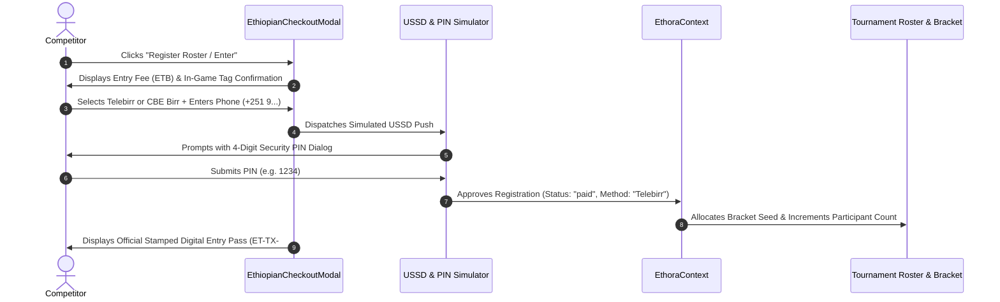

# Ethiopian Mobile Money & Payment Gateway Integration Guide

## 📱 Executive Overview
In Ethiopia, electronic tournament entry fees and prize disbursements are dominated by two primary mobile payment ecosystems:
1. **Telebirr** (operated by Ethio Telecom)
2. **CBE Birr** (operated by the Commercial Bank of Ethiopia)

ETHORA features an interactive, zero-dependency **Mobile Money Checkout Simulator** built directly into the tournament entry flow, with an immediate upgrade path to live production APIs (via [Chapa](https://chapa.co) or direct Ethio Telecom / CBE developer portals).

---

## 🛠️ Current Implementation: Local Checkout Simulation

### User Flow


### Stamped Digital Entry Pass Features
- **Transaction ID**: Unique identifier formatted as `ET-TX-######`.
- **Holographic Stamp**: "PAYMENT STAMPED & VERIFIED - ETHIOPIAN ESPORTS NETWORK".
- **Seed Allocation**: Automatically computes and assigns the next open tournament seed.
- **Offline / Export Capability**: PDF download and clipboard receipt confirmation.

---

## 🚀 Live Production Integration Guide

When ready to transition from simulation to real currency processing:

### Option A: Chapa Integration (Recommended for Multi-Provider Aggregation)
Chapa supports Telebirr, CBE Birr, Awash Birr, and international cards through a single unified REST API.

#### 1. Environment Variables
Add to `.env.local`:
```env
CHAPA_SECRET_KEY=CHASECK_TEST-xxxxxxxxxxxxxxxxxxxx
CHAPA_PUBLIC_KEY=CHAPUBK_TEST-xxxxxxxxxxxxxxxxxxxx
NEXT_PUBLIC_APP_URL=https://ethora.et
```

#### 2. Create Next.js API Route (`src/app/api/payments/initialize/route.ts`)
```typescript
import { NextResponse } from "next/server";

export async function POST(req: Request) {
  const { tournamentId, gamerId, amountETB, email, phone, inGameName } = await req.json();
  const txRef = `ET-TX-${Date.now()}`;

  const response = await fetch("https://api.chapa.co/v1/transaction/initialize", {
    method: "POST",
    headers: {
      Authorization: `Bearer ${process.env.CHAPA_SECRET_KEY}`,
      "Content-Type": "application/json",
    },
    body: JSON.stringify({
      amount: amountETB.toString(),
      currency: "ETB",
      email,
      phone_number: phone,
      first_name: inGameName,
      tx_ref: txRef,
      callback_url: `${process.env.NEXT_PUBLIC_APP_URL}/api/payments/webhook`,
      return_url: `${process.env.NEXT_PUBLIC_APP_URL}/tournaments/${tournamentId}?status=success&tx=${txRef}`,
      "customization[title]": "ETHORA Tournament Sanction Fee",
      "customization[description]": `Entry registration for tournament #${tournamentId}`,
    }),
  });

  const data = await response.json();
  return NextResponse.json(data);
}
```

#### 3. Webhook Handler (`src/app/api/payments/webhook/route.ts`)
```typescript
import { NextResponse } from "next/server";

export async function POST(req: Request) {
  const payload = await req.json();
  // Verify HMAC-SHA256 signature with process.env.CHAPA_WEBHOOK_SECRET
  // Update tournament registration record in database to status = "approved", paymentStatus = "paid"
  return NextResponse.json({ status: "success" });
}
```

---

### Option B: Direct Ethio Telecom Telebirr Integration
For direct zero-fee enterprise contracts with Ethio Telecom:
- Obtain `appId`, `appKey`, and `shortCode` from the Ethio Telecom Partner Portal.
- Implement RSA-2048 signing for the H5 web payment gateway request.
- Receive asynchronous payment notification at your HTTPS endpoint.
